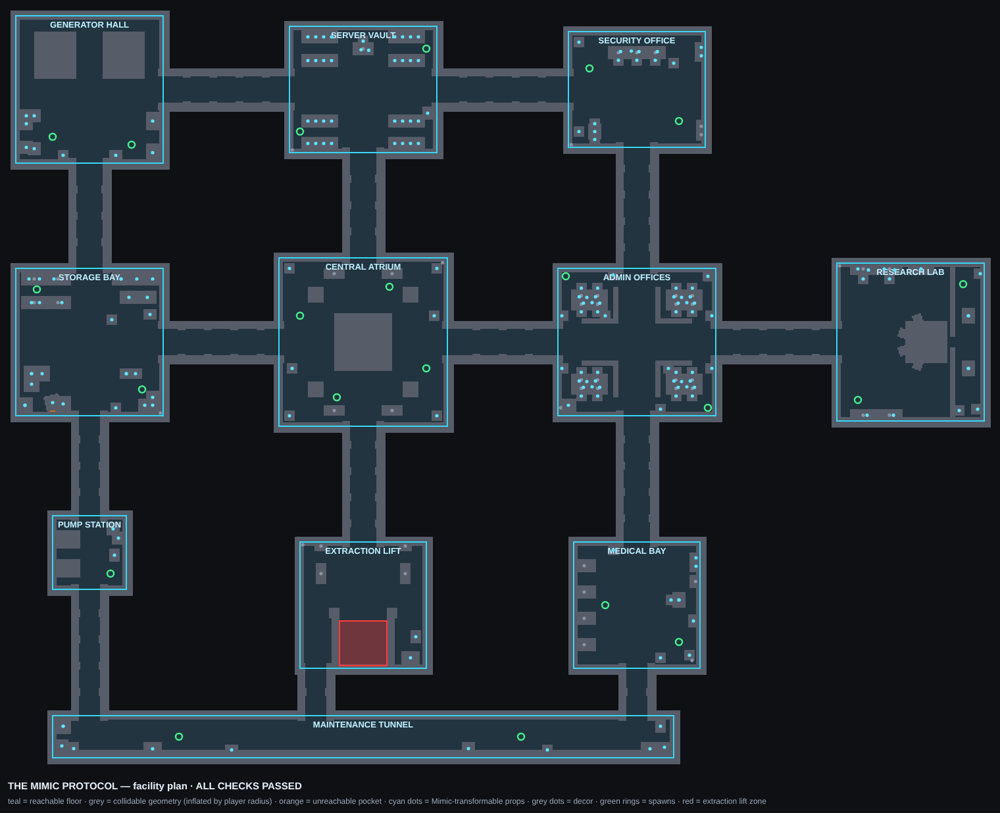

# THE MIMIC PROTOCOL

Social-deduction survival game for Roblox. Survivors try to escape an underground research facility. Mimics, a shapeshifting organism hiding among the crew, try to stop them.

**Current state: Phase 1 (Playable Foundation) is complete.** That covers the full round loop, secret roles, deployment into a 10-room facility, a basic Mimic attack, the extraction lift, and win/loss resolution. See [Progress](#progress) for details.



---

## Quick start (Roblox Studio)

1. Open **`TheMimicProtocol.rbxl`** in Roblox Studio. Every script, remote, UI and map piece is already placed.
2. Test with real multiplayer: **Test → Clients and Servers → 2 players → Start**.
   In Studio a round needs **2** ready players. Public servers need **4** and private servers need **3** (`GameConfig.Players`).
3. Optional: to shorten rounds while testing, set `GameConfig.Dev.FastRoundsInStudio = true`. This only takes effect in Studio.
4. Publish: **File → Publish to Roblox**. No extra API services are needed in Phase 1. DataStores arrive in Phase 5.

Controls: Mimics use **F** (keyboard), **X** (gamepad) or the on-screen button to **ASSIMILATE** a survivor who is close, roughly in front of them, and in line of sight.

## Development workflow (Rojo)

The repository is the source of truth. The place file is generated from it.

```bash
lune run map/build                     # generate the facility → build/*.rbxm
rojo build default.project.json -o TheMimicProtocol.rbxl
rojo serve                             # live-sync into Studio with the Rojo plugin
scripts/check.sh                       # every check (see Testing)
```

Toolchain versions are pinned in `rokit.toml`: Rojo 7.4.4, Lune 0.8.9, luau-lsp 1.70.1, StyLua 0.20.0.

> **Map ownership:** `map/build.luau` generates the map. If you would rather hand-edit the map in Studio, build once, then remove the `Facility` and `DeploymentBay` entries from `default.project.json`. From then on the place file owns the map.

---

## Architecture

```
ReplicatedStorage
  Shared/            (src/shared — safe for client + server)
    Config/GameConfig      every tunable number (players, timings, roles, attack, extraction)
    Modules/Phases         round phase names + metadata
    Modules/RoleAssignment pure, tested: mimic count, weighted fair selection
    Modules/WinConditions  pure, tested: outcome from a round snapshot
    Modules/ChatRules      pure: who can hear whom during a round
    Util/Signal, Janitor, RateLimiter
    Net                    remote accessor + payload types (protocol docs inside)
  Remotes/           9 authored RemoteEvents
  RoundState         Folder whose attributes are the PUBLIC round state
  Assets/Props       22 prop templates (15 Mimic-transformable)
ServerScriptService/Server  (src/server)
  Main                     boots services: Init() all, then Start() all
  Services/PlayerRegistry  readiness, sit-out toggle, public Status, teams
  Services/MatchState      phase + participants + secret roles (server only)
  Services/CharacterService all spawning (CharacterAutoLoads = false)
  Services/RoleService     role assignment + private delivery + replacement
  Services/EliminationService ASSIMILATE validation, deaths → eliminations
  Services/ExtractionService  lift gates, boarding zone, extraction
  Services/FacilityService lighting modes (Normal / Emergency)
  Services/ChatService     dead/extracted players can't talk to the living
  Services/Announcer       server-authored banners
  Services/RoundService    the state machine (only it advances phases)
StarterPlayerScripts/Client (src/client)
  Main + Controllers/      State, Hud, Ability, Lobby, Announcement,
                           RoleReveal, Results, BayScreen, Effects, CoreGui
  UI/Theme, UI/Components  design tokens + reusable UI constructors
Workspace
  Facility/  Architecture, Props (tagged MimicProp), Spawns, Zones, Extraction
  DeploymentBay/  pre-round lobby with status screen + holo-table mini-map
```

### Round flow

`Waiting → Intermission (20s) → RoleReveal (7s) → Deployment (20s) → Active (210s) → Escalation (90s) → Extraction (40s) → Results (12s)`, which comes to about 6.8 minutes.

- **Waiting:** too few ready players. The server re-checks on every readiness change rather than polling.
- **Intermission:** countdown in the Deployment Bay. If players leave or sit out, the round is postponed.
- **RoleReveal:** roles are assigned and each player is told privately. Mimics learn who their fellow Mimics are.
- **Deployment:** players are teleported to scattered spawn points. Mimic abilities are still dormant.
- **Active:** Mimics can ASSIMILATE. The first attack is possible 15 seconds in, then there is a 22-second cooldown.
- **Escalation:** emergency lighting, red grade, rising tension.
- **Extraction:** the lift gate opens. Survivors who step inside escape.
- **Results:** shows the winner, the reason, and every player's role.

### Win conditions (`WinConditions.luau`, unit-tested)

| Outcome | When |
|---|---|
| Survivors win | at least ⅓ of the survivor pool (min 1) is extracted, or every Mimic is gone |
| Mimics win | the quota becomes unreachable, the facility is overrun, or the lift departs short |
| Cancelled | every participant left, or the round faulted, or the outcome was decided before Active |

The game re-evaluates these on every fate change (elimination, extraction, disconnect) instead of polling. A survivor who disconnects leaves the pool, so one quitter can't decide the round. If every Mimic leaves before Active, a random survivor is **promoted** to Mimic.

### Security model

- Roles never touch a replicated object. They're sent with `FireClient` only to their owner, and to fellow Mimics.
- Public counts are anonymous: operatives remaining, extracted / required, and Mimic count at start. The game never publishes how many Mimics are *still alive*.
- `RequestStrike` carries **no arguments**. The server checks role, phase, cooldown (claimed before any work), range, facing and line of sight, then picks the target itself.
- Every client→server remote is token-bucket rate-limited and type-checked.
- Elimination effects broadcast a position only, never the attacker.
- Every wait is bounded and interruptible. Any error inside a round cancels it, returns everyone to the bay, and the loop continues.

---

## Testing

`scripts/check.sh` runs these steps (none of them needs Roblox):

| Check | What it proves |
|---|---|
| `lune run map/build` + `tests/layout_check.py` | Rasterises every collidable part at body height and flood-fills it. All 11 rooms are 100% reachable, all 21 spawns are clear, the lift is reachable when open and sealed when closed. |
| `luau-lsp analyze` | The whole codebase type-checks against current Roblox API definitions. |
| `lune run tests/run` | 24 unit tests: role fairness (statistical), weighting, win conditions, rate limiter. |
| `lune run tests/sim/client` | 49 checks: the real client controllers run against a mocked runtime. Covers readiness toggle, timer, reveal, HUD, ability gating and cooldown, location, banners, results, input unbinding. |
| `lune run tests/sim/run` | 80 checks: the **real server code** runs six consecutive rounds with simulated players (extraction win, assimilation win, strike validation, Mimic disconnect, replacement Mimic, timer ending, AFK and intermission abort, late joiner, chat isolation, fault recovery). |

**Not verified here:** anything that needs the real engine. That includes visual look and UI layout on real devices, physics and character feel, lighting performance, and real network latency. Use the Studio checklist below for those.

### Studio checklist

Run through the Studio MCP on 2026-11-23 (Server & Clients with 2–3 players, `FastRoundsInStudio` on):

- [x] Full rounds: reveal, HUD and timer look right; players deploy to different rooms.
- [x] Assimilate from behind a crate fails (line of sight); in the open it succeeds.
- [x] Walking into the open lift extracts you and sends you to the bay (fixed: the extraction that *ended* the round used to leave that survivor in the lift).
- [x] Phone landscape (iPhone 17 Pro, Galaxy A06): HUD, Standby panel, reveal and debrief fit; the ability button sits above the jump button (fixed: it used to overlap).
- [x] MicroProfiler, Atrium and Server Vault, normal and emergency lighting: about 4.2 ms CPU and 0.4–0.6 ms GPU per frame on a desktop GPU. Phones are untested on real hardware.
- [ ] Chat isolation end to end. Studio's local multi-client test doesn't deliver chat between clients, even with an allow-all callback, so check it on a published private server.

---

## Progress

### Phase 1 — Playable foundation ✅
- [x] Rojo project, tooling, verification pipeline
- [x] Modular facility with 10 rooms, 14 corridors, loops and dead ends, signage, zones, mini-map
- [x] Reusable prop library: 22 types, 15 Mimic-transformable, one builder per prop so disguises match exactly
- [x] Deployment Bay lobby with status screen
- [x] Round state machine covering intermission, readiness check, reveal, deployment, escalation, extraction and results
- [x] Fair, weighted, secret role assignment with replacement on early disconnect
- [x] Win conditions, disconnect, late-join and fault handling
- [x] Basic elimination (ASSIMILATE) and extraction lift, so both teams can actually win
- [x] Client UI: HUD, role reveal, Standby panel, banners, debrief, ability bar
- [x] Chat isolation for eliminated players; reset disabled in the facility

### Next — Phase 2 (core gameplay)
- Object Shift: transform into tagged `MimicProp` models (templates already in `Assets/Props`)
- Identity Theft: copy a player's `HumanoidDescription` and `Humanoid.DisplayName`
- System Sabotage: lights, cameras, generator progress, false alerts, lockdowns
- Generator repair objective that gates the extraction lift
- Survivor counterplay (see the open question below)

### Open design question
The brief gives survivors no direct way to **act** on a suspicion; they can only survive and escape. Most social-deduction games need one, otherwise investigating has no payoff. My recommendation is a limited **Containment Scanner**: each survivor gets one charge to tag a suspect. A Mimic hit is revealed and stunned. Tagging a fellow survivor costs the whole team extraction time.
